<div align="center">


# Mr.Jackpot 🍷

**특별한 날, 집에서 편안하게 — 소중한 사람을 감동시키는 프리미엄 디너 배달 서비스**

말 한마디로 주문하는 **AI 음성 주문**부터 주방·배달 직원용 **실시간 주문 관리**까지,<br/>
고객과 직원을 하나의 웹 서비스로 연결합니다.

<br/>


[주요 기능](#-주요-기능) · [화면 미리보기](#-화면-미리보기) · [음성 주문](#-ai-음성-주문은-이렇게-동작해요) · [기술 스택](#-기술-스택) · [산출물](#-프로젝트-산출물) · [시작하기](#-시작하기)

</div>

<br/>

> [!NOTE]
> 이 저장소는 **프론트엔드**입니다. API 서버(Spring Boot)는 비공개 저장소에서 관리되며, 구조와 설계는 [프로젝트 산출물](#-프로젝트-산출물)에서 확인할 수 있어요.

<br/>

## 📖 프로젝트 소개

**Mr.Jackpot(미스터 대박)** 은 고객의 집으로 고급 디너를 배달하는 서비스입니다.
고객은 웹에서 디너와 서빙 스타일을 고르고, 구성품을 원하는 대로 바꾼 뒤 배달 시간과 주소를 지정해 주문합니다.
버튼을 누르고 말로 주문하는 **음성 주문**도 지원합니다.

직원은 같은 서비스에서 들어온 주문을 **접수 → 조리 → 배달 → 완료** 순서로 처리하고, 주방 재고를 관리합니다.

<br/>

## ✨ 주요 기능

### 👤 고객

| 기능 | 설명 |
| --- | --- |
| 🍽️ **메뉴 & 커스터마이징** | 4가지 디너와 3가지 서빙 스타일 선택, 구성품(스테이크·와인·커피 등) 수량 추가/제외 |
| 🎙️ **AI 음성 주문** | 마이크 버튼을 누르고 말하면 AI가 대화하며 날짜·디너·스타일·구성을 정리해 장바구니에 담아줌 |
| 🛒 **장바구니 & 주문** | 배달 일시·주소·결제수단 입력 후 주문, 재고 부족 시 자동 안내 |
| 👑 **VIP 할인** | 배달 완료 주문이 10건 이상인 단골 고객에게 **10% 자동 할인** |
| 📋 **주문 내역** | 주문 시간·디너 구성·가격·배달 시간·주소 확인, 주문 취소 및 **원클릭 재주문** |
| ⚙️ **마이페이지** | 회원 정보 수정, 배달 주소 관리, 결제수단 관리 |

### 🧑‍🍳 직원

| 기능 | 설명 | 접근 권한 |
| --- | --- | --- |
| 📦 **주문 관리** | 신규·진행 중·완료 주문을 한눈에 보고 단계별로 상태 변경 | 주방 / 배달 |
| 🥩 **재고 관리** | 재료별 재고 확인·수정, 10개 미만 품목 경고 표시 | 주방 |

> 로그인한 계정의 역할(`CUSTOMER`, `KITCHEN_STAFF`, `DELIVERY_STAFF`)에 따라 접근 가능한 화면이 자동으로 나뉩니다.

<br/>

## 📸 화면 미리보기

<!-- 스크린샷은 docs/assets/screenshots/ 폴더에 아래 파일명으로 넣으면 바로 표시됩니다. -->

<table>
  <tr>
    <td align="center"><b>랜딩 페이지</b></td>
    <td align="center"><b>메뉴 선택</b></td>
  </tr>
  <tr>
    <td>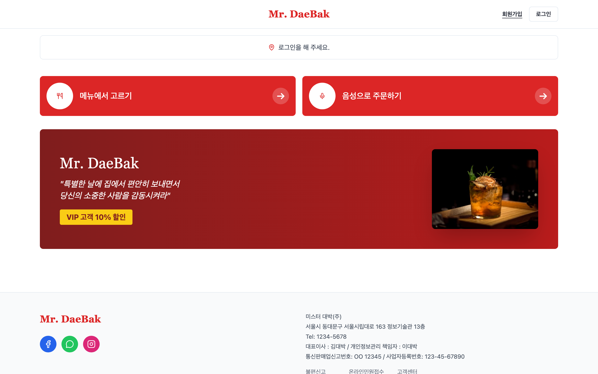</td>
    <td>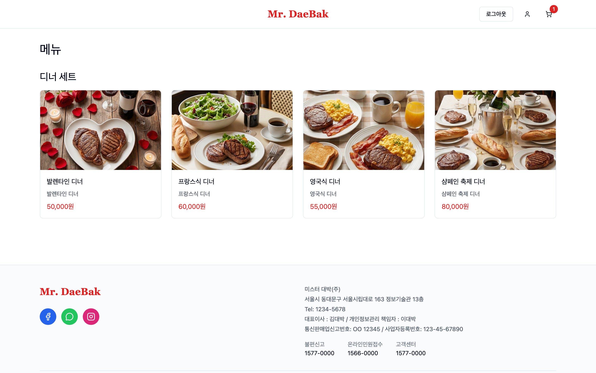</td>
  </tr>
  <tr>
    <td align="center"><b>AI 음성 주문</b></td>
    <td align="center"><b>장바구니</b></td>
  </tr>
  <tr>
    <td>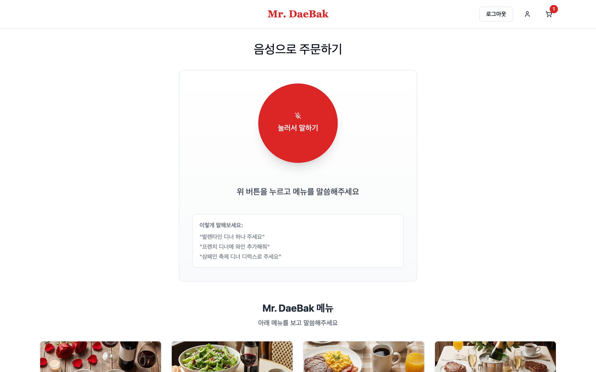</td>
    <td>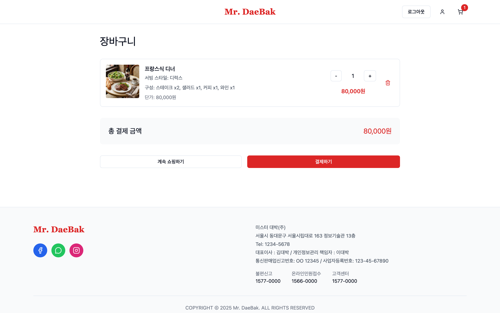</td>
  </tr>
  <tr>
    <td align="center"><b>주문 내역</b></td>
    <td align="center"><b>직원 · 주문 관리</b></td>
  </tr>
  <tr>
    <td>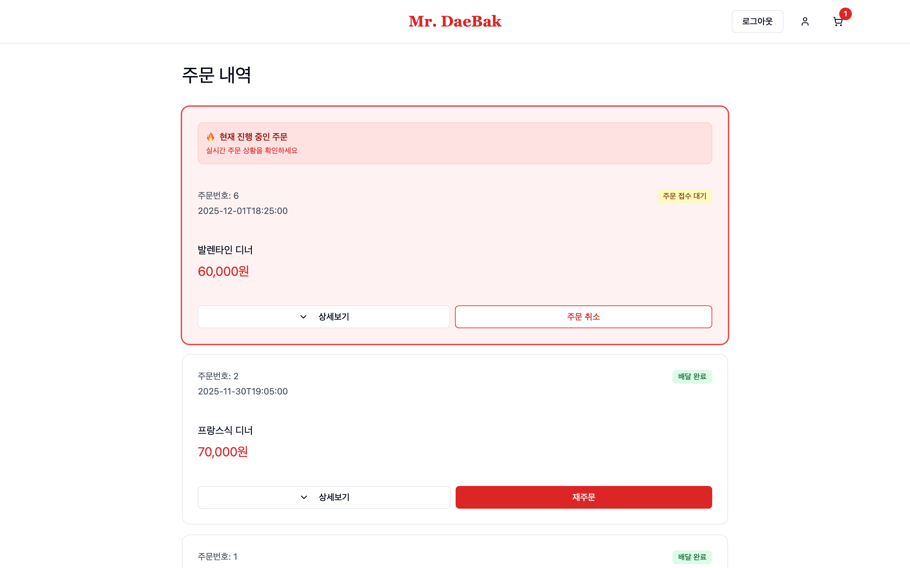</td>
    <td>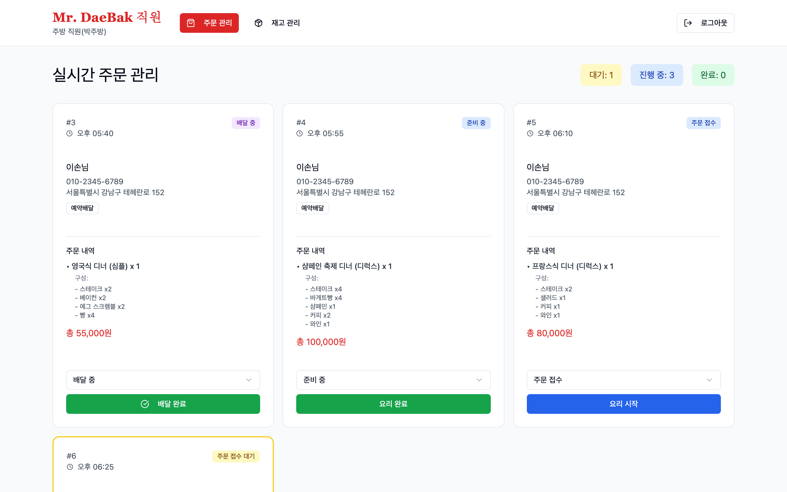</td>
  </tr>
  <tr>
    <td align="center"><b>직원 · 재고 관리</b></td>
    <td align="center"><b>마이페이지</b></td>
  </tr>
  <tr>
    <td>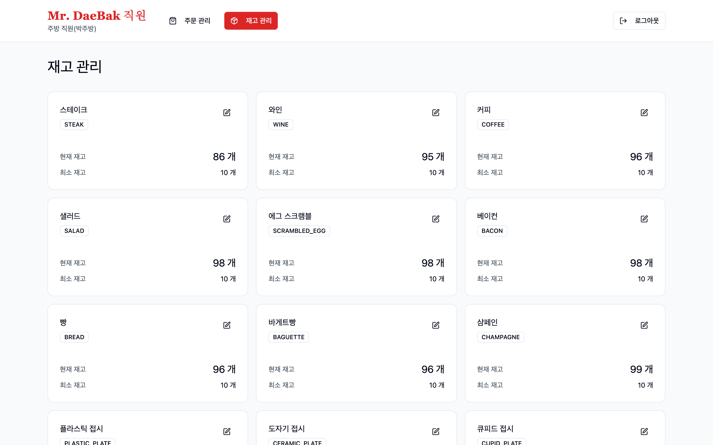</td>
    <td>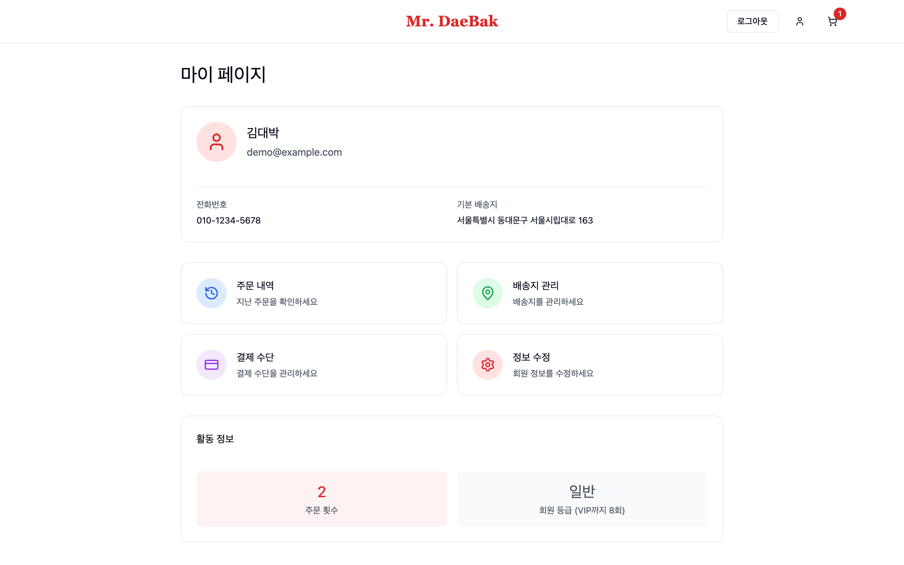</td>
  </tr>
</table>

<br/>

## 🍷 메뉴 구성

<table>
  <tr>
    <td align="center" width="25%"><br/><b>발렌타인 디너</b></td>
    <td align="center" width="25%">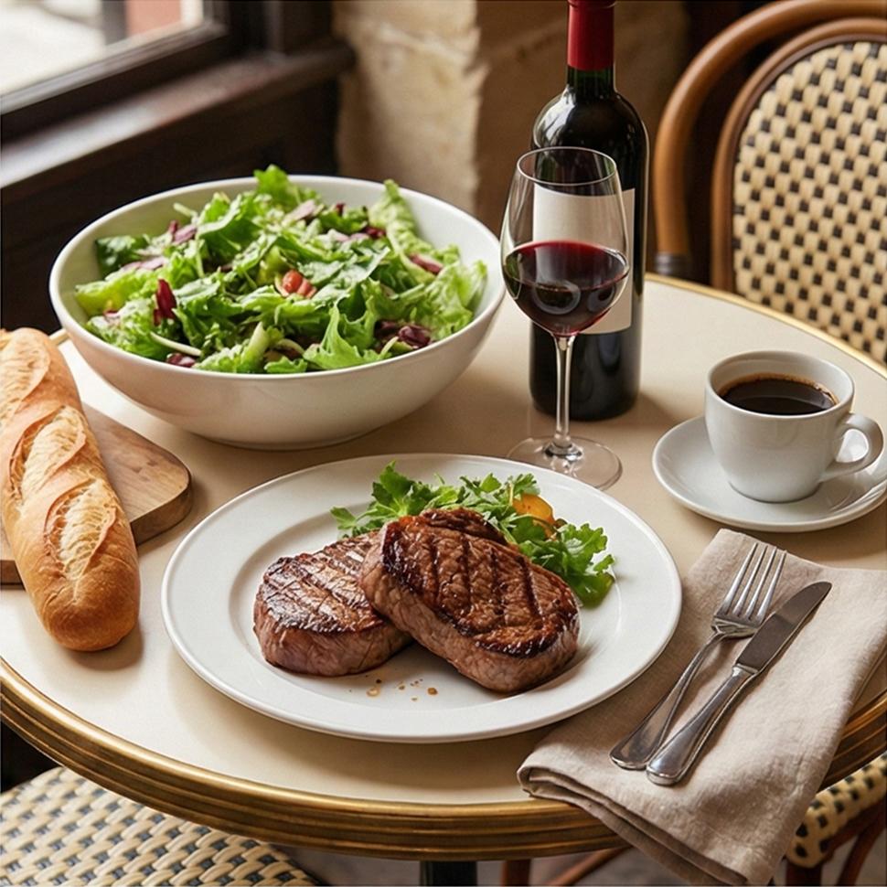<br/><b>프렌치 디너</b></td>
    <td align="center" width="25%">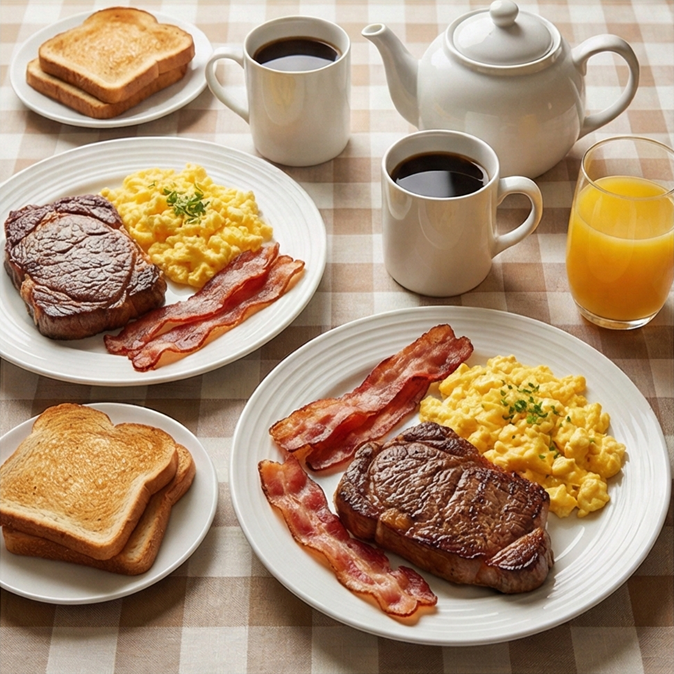<br/><b>잉글리시 디너</b></td>
    <td align="center" width="25%"><br/><b>샴페인 축제 디너</b></td>
  </tr>
  <tr>
    <td>하트·큐피드 장식 접시에 와인과 스테이크</td>
    <td>커피, 와인, 샐러드, 스테이크</td>
    <td>에그 스크램블, 베이컨, 빵, 스테이크</td>
    <td>2인 식사 · 샴페인 1병, 바게트 4개, 커피 포트, 와인, 스테이크</td>
  </tr>
</table>

| 서빙 스타일 | 구성 |
| --- | --- |
| **심플** | 플라스틱 접시·컵, 종이 냅킨, 플라스틱 쟁반 |
| **그랜드** | 도자기 접시·컵, 흰색 면 냅킨, 나무 쟁반 |
| **디럭스** | 꽃병 장식, 도자기 접시·컵, 린넨 냅킨, 나무 쟁반, 유리 와인잔 |

> 샴페인 축제 디너는 **그랜드 / 디럭스** 스타일로만 주문할 수 있습니다.

<br/>

## 🎙️ AI 음성 주문은 이렇게 동작해요

브라우저에서 녹음한 음성을 서버로 보내면, 서버가 **Whisper**로 텍스트로 바꾸고 **LLM**이 대화 맥락을 이어가며 주문서를 채웁니다.
세션이 유지되므로 *"프렌치 디너로 할게요"* → *"와인은 빼주세요"* 처럼 여러 번에 나눠 말해도 됩니다.

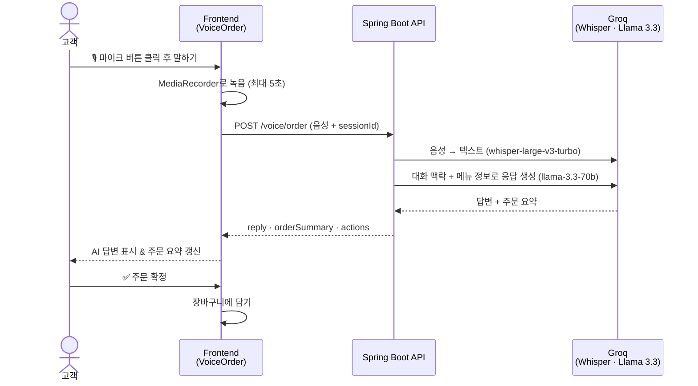

<br/>

## 🔄 주문 상태 흐름

직원 화면에서 버튼 한 번으로 다음 단계로 넘어갑니다.

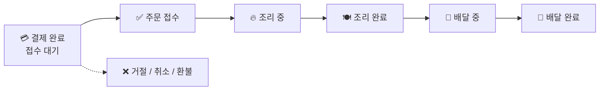

<br/>

## 🏗️ 시스템 구성

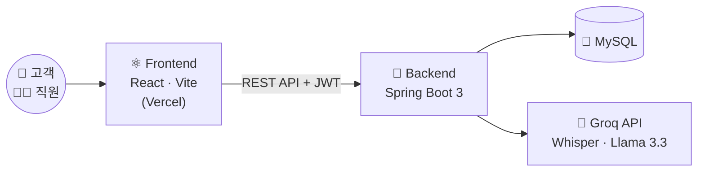

<br/>

## 🛠 기술 스택

| 분류 | 사용 기술 |
| --- | --- |
| **Core** | React 19, TypeScript 5.9, Vite 7 |
| **Routing** | React Router DOM 7 (역할 기반 보호 라우트) |
| **Styling / UI** | Tailwind CSS 3, shadcn/ui (Radix UI), lucide-react |
| **State** | React Context API (`AuthContext`, `CartContext`, `StockContext`) |
| **Feedback** | Sonner (토스트 알림), Embla Carousel |
| **Auth** | JWT (localStorage 보관, 요청 시 `Authorization` 헤더 자동 첨부) |
| **Audio** | MediaRecorder API |
| **Deploy** | Vercel |

<br/>

## 📂 프로젝트 구조

```
src/
├── pages/
│   ├── LandingPage.tsx        # 서비스 소개 메인
│   ├── LoginPage.tsx
│   ├── SignupPage.tsx
│   ├── customer/              # 고객 화면 (메뉴, 장바구니, 음성 주문, 주문 내역, 마이페이지 …)
│   └── staff/                 # 직원 화면 (주문 관리, 재고 관리)
├── components/
│   ├── layout/                # Header, Footer
│   ├── ui/                    # shadcn/ui 컴포넌트
│   └── ProtectedRoute.tsx     # 역할 기반 접근 제어
├── contexts/                  # 인증 · 장바구니 · 재고 전역 상태
├── services/                  # API 클라이언트 및 도메인별 서비스 (auth, menu, order, voice …)
├── utils/                     # 메뉴 이미지, 재고 계산 등 헬퍼
└── assets/                    # 디너 이미지
```

<br/>

## 📑 프로젝트 산출물

계획부터 분석·설계·구현까지, 소프트웨어 공학 프로세스에 따라 작성한 문서입니다.

| 단계 | 문서 | 주요 내용 |
| --- | --- | --- |
| 📋 계획 | [프로젝트 계획서](docs/알파카앞발털파카_프로젝트계획서.pdf) | 개발 목표, 평가 방법, 일정, 위험 분석, 개발 환경 |
| 🔍 분석 | [분석 산출물](docs/알파카앞발털파카_분석산출물.pdf) | 유즈케이스도, 유즈케이스 명세 및 시나리오, 액티비티도 |
| 📐 설계 | [설계 산출물](docs/알파카앞발털파카_설계산출물.pdf) | 아키텍처도, 클래스도, 교류도, 주문 상태도 |
| 🛠️ 구현 · 운영 | [구현 및 운영 산출물](docs/알파카앞발털파카_구현운영산출물.pdf) | 컴포넌트도, 배치도 |

<br/>

## 🚀 시작하기

### 요구 사항

- [Node.js](https://nodejs.org/) 20 이상 (LTS 권장)
- 실행 중인 백엔드 API 서버 (비공개 저장소)

### 설치 및 실행

```bash
# 1. 저장소 클론
git clone https://github.com/Mr-Jackpot-DinnerService/MrJackpot-frontend.git
cd MrJackpot-frontend

# 2. 의존성 설치
npm install

# 3. 환경 변수 설정
cp .env.example .env

# 4. 개발 서버 실행
npm run dev
```

브라우저에서 `http://localhost:5173` 으로 접속하세요.

### 환경 변수

| 변수 | 설명 | 예시 |
| --- | --- | --- |
| `VITE_API_URL` | 백엔드 API 주소 | `http://localhost:8080/api` |

> 값을 지정하지 않으면 `http://localhost:8080/api` 를 기본으로 사용합니다.

### 스크립트

| 명령어 | 설명 |
| --- | --- |
| `npm run dev` | 개발 서버 실행 |
| `npm run build` | 프로덕션 빌드 |
| `npm run build:check` | 타입 검사 후 프로덕션 빌드 |
| `npm run preview` | 빌드 결과물 미리보기 |
| `npm run lint` | ESLint 검사 |

<br/>

## 👥 팀 알파카앞발털파카

2025년 2학기 소프트웨어공학 팀 프로젝트로 진행했습니다. (2025.09 – 2025.12)

| 이름 | 역할 |
| --- | --- |
| **이태권** | 프론트엔드(React) 개발, 배포 인프라 관리 |
| **박주영** | 프로젝트 매니저, 주문 인터페이스 백엔드(Spring) |
| **최문기** | 직원 인터페이스 백엔드(Spring), AI 음성 주문 |
